# Awesome Webhooks & Event Notification System

 
 

  <strong>🚀 A comprehensive, production-grade directory of Webhooks-as-a-Service (WaaS), Event Gateways, Notification Engines, and Local Webhook Debugging Tools.</strong>

  <a href="#-table-of-contents">Documentation</a> •
  <a href="#-sector-overview--market-dynamics">Market Analysis</a> •
  <a href="#-saas--hosted-platforms">Commercial SaaS</a> •
  <a href="#-open-source-software">Open Source</a> •
  <a href="#-comparison-at-a-glance">Feature Matrix</a> •
  <a href="#-support--sponsor">Support</a>

---

> 💡 **Search Keywords / Topics:** *webhooks, event-driven architecture, webhooks as a service, event notification system, webhook proxy, webhook gateway, event delivery, HMAC verification, retry logic, dead letter queue, event routing, transactional notifications, Svix, Hookdeck, Novu.*

---

## 📋 Table of Contents

- [📈 Sector Overview & Market Dynamics](#-sector-overview--market-dynamics)
- [🟦 SaaS / Hosted Platforms](#-saas--hosted-platforms)
- [🟩 Open-Source Software](#-open-source-software)
- [📊 Comparison at a Glance](#-comparison-at-a-glance)
- [🌟 Star History](#-star-history)
- [💖 Support & Sponsor](#-support--sponsor)
- [🤝 Contributing](#-contributing)
- [📄 License](#-license)

---

## 📈 Sector Overview & Market Dynamics

The global **Event-Driven Architecture (EDA)** and webhook infrastructure market is estimated at approximately **$3.7 billion** (projected to expand at a **21.5% CAGR**), catalyzed by the explosive growth of microservices decoupling, third-party API ecosystems, and asynchronous agentic AI triggers. 

The sector displays **moderate fragmentation paired with tiered concentration**:
- 🌐 **Workflow Automation & Glue Layers:** Concentrated around dominant multi-billion dollar ecosystems (such as Celonis/Make and Zapier) capturing broad end-user workflows.
- ⚙️ **Dedicated Webhooks-as-a-Service (WaaS) & Gateways:** Specialized and fragmented across developer-first infrastructure providers (Svix, Hookdeck, Convoy, Novu) competing on sub-millisecond dispatch SLAs, zero-loss ingestion buffering, HMAC signature standardization, and granular event observability.

---

## 🟦 SaaS / Hosted Platforms

⚡ Commercial, cloud-hosted Webhook and Event Notification platforms sorted by company scale (valuation / annual revenue, descending).

| 🏢 Platform | 🏷️ Type | 💰 Scale (Valuation / Revenue) | 💳 Paid Pricing (Starting Tier) | 🎁 Free Tier Limits | 🚀 Key Highlights |
| :--- | :--- | :--- | :--- | :--- | :--- |
| **Make Webhooks** | Visual automation glue & webhook triggers | **$13.0B valuation** *(Parent: Celonis; ~$400M–$771M ARR)* | **$9.00 / month** *(Core plan, billed annually at $108/yr)* | **1,000 operations/month**, 2 active scenarios, 15-min minimum scheduling interval, 5 MB file execution cap *(Free forever)* | Visual scenario orchestrator with instant webhook triggers and response modules. |
| **Zapier Webhooks** | Automation glue & webhook triggers | **$5.0B valuation** *(~$310M ARR, profitable)* | **$19.99 / month** *(Professional plan, billed annually; or $29.99/mo)* | **100 tasks/month**, unlimited 2-step Zaps, 15-min update intervals, 1 user seat *(Free forever)* | Connects webhook-emitting applications to 7,000+ destinations without custom code. |
| **RequestBin** | Request inspection, mocking & event debugging | **$80M valuation** *(Acquired by Workday; parent Pipedream)* | **$12.00 / month** *(RequestBin Pro plan)* | **3 named bins**, 500 requests/bin/day, latest 100 requests history, 1 mock API, 5 API keys *(Free forever)* | Dedicated endpoint generator for capturing, inspecting, and relaying incoming webhook payloads. |
| **Pipedream** | Developer-focused event source & workflow runtime | **$80M valuation** *(Acquired by Workday; $20M Series A raised)* | **$99.00 / month** *(Startup plan, billed annually; or $150/mo)* | **Daily pool capped at ~100 credits/month** (1 credit = 30s compute @ 256MB), development/testing environment only *(Free forever)* | Code-level webhook trigger manipulation supporting Node.js/Python serverless actions. |
| **Courier** | Multi-channel notification & webhook orchestration | **~$57M venture funding raised** *(Bessemer, GV, Twilio)* | **$0.005 / notification** *(Pay-as-you-go Pro tier, no mandatory base minimum)* | **10,000 sends/month**, multi-channel delivery (webhooks, email, push, SMS), 1 user seat *(Free forever)* | Orchestrates cross-channel transactional notifications with outbound webhook delivery routing. |
| **Svix** | Dedicated Webhooks-as-a-service infrastructure | **~$25M–$50M valuation** *($13.1M venture funding raised; a16z)* | **$20.00 / month** *(Basic plan + usage consumption)* | **50,000 messages/month**, 50 messages/sec throughput, 7-day log retention *(Free forever)* | Turnkey outbound webhooks with HMAC signatures, retry queuing, schema validation, and customer portal. |
| **Hookdeck** | Event gateway, proxy & inbound queueing | **~$10M–$15M valuation** *($2.7M venture funding raised; Matrix Partners)* | **$39.00 / month** *(Team plan; or $10/M events on Outpost Starter)* | **10,000 events/month**, 3-day data retention, 1 user seat *(Free forever)* | Resilient webhook gateway providing buffering, exponential backoff retries, and local tunneling. |
| **Webhook.site** | Instant webhook testing & payload inspection | **~$250K+ ARR** *(Bootstrapped by Simon Fredsted / Webhook ApS)* | **$9.00 / month** *(Basic plan; or $90/year)* | **50 requests max per URL**, 50 requests storage history, temporary URLs auto-expire after 7 days *(Free forever)* | Zero-setup browser endpoint for immediate HTTP request inspection, header debugging, and automated scripts. |

---

## 🟩 Open-Source Software

🛠️ Self-hosted, community-driven Webhook and Event Notification tools sorted by GitHub stargazers count (descending).

| 📦 Repository | ⭐ GitHub_Stars | 💻 Stack | 📜 License | 📝 Description |
| :--- | :--- | :--- | :--- | :--- |
| **Novu** |  | TypeScript / Node.js | MIT / Apache-2.0 | The open-source communication infrastructure for agents and products. Orchestrates transactional notifications with webhook destinations, subscriber preferences, workflows, and multi-channel delivery. |
| **adnanh/webhook** |  | Go | MIT | A lightweight incoming webhook server that lets you easily configure HTTP endpoints to execute shell commands and automation pipelines on your server. |
| **Webhook.site (OSS)** |  | PHP / Laravel / Vue.js | MIT | Self-hosted version of Webhook.site to test, inspect, and debug incoming HTTP webhooks, requests, and email payloads with an instant real-time web UI. |
| **Svix (Core)** |  | Rust | MIT / Apache-2.0 | Enterprise-ready, open-source webhooks-as-a-service engine written in Rust. Features reliable outbound delivery, HMAC verification, retry mechanisms, and tenant management. |
| **Convoy** |  | Go | MPL-2.0 / Business Source | High-performance, cloud-native webhooks proxy and gateway supporting both incoming provider webhooks and outgoing customer event publishing. |
| **Standard Webhooks** |  | Multi-language SDKs | Apache-2.0 | Open, industry-wide specification for secure and uniform webhook delivery, signatures, headers, and payload verification, backed by Svix and industry contributors. |
| **Hook0** |  | Rust | LGPL-3.0 | Open-source webhooks-as-a-service server providing tenant management, event routing, webhook subscriptions, and delivery retry instrumentation. |
| **webhookd** |  | Go | MIT | A minimalist, powerful webhook server designed to trigger shell scripts, Docker containers, and external worker processes from HTTP notifications. |
| **Hookdeck Outpost** |  | Go | Apache-2.0 | Open-source outbound webhooks infrastructure by Hookdeck. Delivers reliable event routing, topic fanout, multi-tenancy, and at-least-once delivery to webhooks, SQS, EventBridge, Kafka, and GCP Pub/Sub. |
| **Webhook Tester** |  | Go / React | MIT | Self-hosted alternative to RequestBin and Webhook.site with real-time WebSocket UI updates, customizable mock responses, and Docker packaging. |
| **WebhookX** |  | Go | Apache-2.0 | Extensible webhook gateway for receiving, validating, transforming, and fanning out webhook events with WASM plugin support, rate limiting, and GitOps configuration. |
| **fasthook** |  | TypeScript / Node.js | MIT | Local webhook receiver and tunneling CLI that forwards incoming webhook traffic directly to localhost environments for local testing without cloud dashboards. |

---

## 📊 Comparison at a Glance

| 🛠️ Software | 📜 License | 🏷️ Type | 📥 Inbound | 📤 Outbound | 🖥️ Self-Hosted | 🎯 Best For |
| :--- | :--- | :--- | :---: | :---: | :---: | :--- |
| **Novu** | Open Source (MIT) | Notification engine | ✅ | ✅ | ✅ | Multi-channel & webhook notifications |
| **Svix** | Open Source (MIT core) / SaaS | Webhooks-as-a-service | ❌ | ✅ | ✅ | Turnkey outbound webhooks with portal |
| **Hookdeck** | Open Source (Outpost) / SaaS | Event gateway | ✅ | ✅ | ✅ (Outpost) | Webhook proxy, buffering & fanout |
| **adnanh/webhook** | Open Source (MIT) | Webhook runner | ✅ | ❌ | ✅ | Executing server scripts via webhooks |
| **Webhook.site** | Open Source (MIT) / SaaS | Testing & inspection | ✅ | ❌ | ✅ | Fast payload debugging & capture |
| **Convoy** | Open Source / SaaS | Webhook gateway | ✅ | ✅ | ✅ | Inbound + outbound gateway at scale |
| **Zapier Webhooks** | Commercial SaaS | Automation glue | ✅ | ✅ | ❌ | No-code multi-app triggers |
| **Make Webhooks** | Commercial SaaS | Automation glue | ✅ | ✅ | ❌ | Complex visual workflow branching |
| **Pipedream** | Commercial SaaS | Event source / runtime | ✅ | ✅ | ❌ | Developer code-first integrations |
| **RequestBin** | Commercial SaaS | Testing & inspection | ✅ | ❌ | ❌ | Capturing & relaying HTTP payloads |
| **Hook0** | Open Source (LGPL-3.0) | Webhooks platform | ❌ | ✅ | ✅ | EU data-resident webhook dispatch |
| **webhookd** | Open Source (MIT) | Webhook script trigger | ✅ | ❌ | ✅ | Lightweight shell automation server |
| **Webhook Tester** | Open Source (MIT) | Testing & inspection | ✅ | ❌ | ✅ | Self-hosted inspector UI |
| **WebhookX** | Open Source (Apache-2.0) | Webhook gateway | ✅ | ✅ | ✅ | WASM-extensible event gateway |
| **fasthook** | Open Source (MIT) | Local tunnel / receiver | ✅ | ❌ | ✅ | Local development & forwarding |

---

##  Star History

---

## 💖 Support & Sponsor

Thank you for exploring and using **Awesome Webhooks & Event Notification System**! 🙏

If you found this list helpful for building your developer stack or discovering new tools, please consider showing your support:
- ⭐ **Star this repository** to help others discover it on GitHub.
- 🍴 **Fork the repository** and contribute your own discoveries or updates.
- 📢 **Share it** on X / Twitter, LinkedIn, Reddit, or developer Discord channels.
- ☕ **Buy me a coffee / Sponsor:** If you'd like to support ongoing maintenance and new curated resources, you can sponsor through the dashboard:
  
  👉 **[Sponsor Ishan Dutta on GitHub](https://github.com/sponsors/ishandutta2007)** 💖

---

## 🤝 Contributing

Contributions are very welcome! If you know of an open-source Webhook or Event Notification tool that should be listed here, please open a pull request with:

- 🏷️ Project name and URL
- 📝 Brief description (1–2 sentences)
- 💻 Stack and license
- 💡 Why it stands out

Please ensure the project is actively maintained (releases within the last 12 months) and genuinely open-source.

---

## 📄 License

This list is released under [CC0 1.0 Universal (Public Domain)](https://creativecommons.org/publicdomain/zero/1.0/). The individual software projects listed retain their respective licenses.

---

  ⭐ <strong>If this list helped you discover a useful tool, please star the repo!</strong> ⭐

